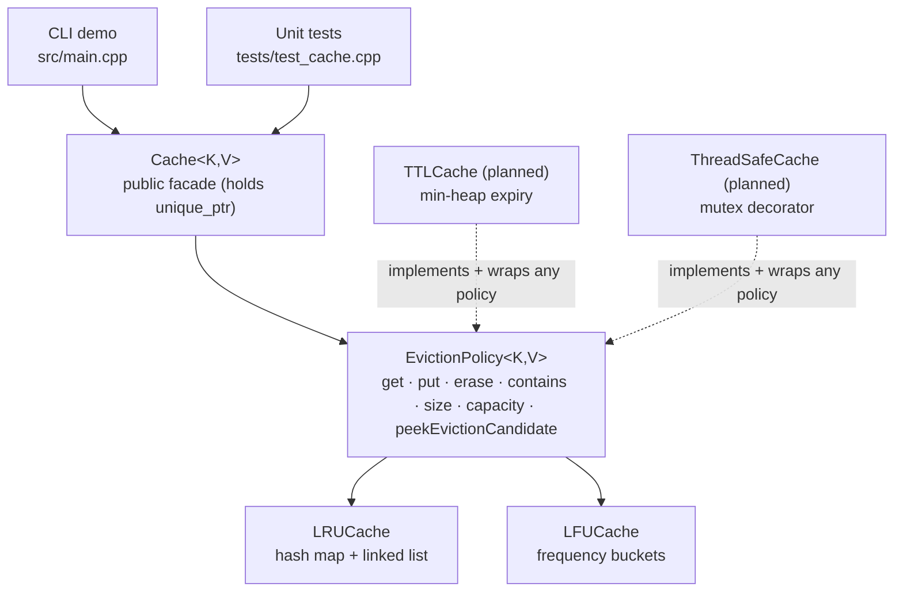

# Architecture

CacheSim uses three classic patterns:

- **Strategy** — interchangeable eviction policies behind one `EvictionPolicy<K,V>` interface
- **Facade** — a single public `Cache<K,V>` class that owns the active policy
- **Decorator** — `TTLCache` / `ThreadSafeCache` add behaviour to *any* policy without modifying it (planned, Phase 3)

## Components

| Component | Role |
|---|---|
| `EvictionPolicy` | Abstract interface every policy implements; keeps `Cache` policy-agnostic |
| `LRUCache` | Evicts the least recently used entry; `unordered_map<K,Node*>` + intrusive doubly linked list with sentinel head/tail nodes |
| `LFUCache` | Evicts the least frequently used entry; ties broken by recency (LRU). Frequency-bucket construction (Shah, Mitra, Matani 2010) |
| `Cache` | Facade owning `unique_ptr<EvictionPolicy>`; supports runtime policy swap |
| `TTLCache` *(planned)* | Decorator; expiry tracked in a min-heap, stale entries skipped via per-key generation counters |
| `ThreadSafeCache` / `ShardedCache` *(planned)* | Mutex decorator; N independently locked shards |

## Design decisions

**LRU.** A touch relinks the node at the head; eviction reads the tail. Sentinel nodes remove all
null-pointer edge cases.

**LFU.** A map from frequency to an LRU-ordered bucket, a second map from key to bucket iterator
for O(1) lookup, and an incrementally maintained `minFreq_` so eviction never scans.
`minFreq_` is updated wherever a bucket can become the new minimum or empty out.
*Known limitation:* `erase()` of the last key in the minimum bucket calls `recomputeMinFreq()`,
which scans the bucket map — O(distinct frequencies), not O(1). `get`/`put`/eviction remain O(1).

**Minimal interface.** TTL and thread-safety are decorators that wrap any policy, so LRU and LFU
never need to change again when those features land.
